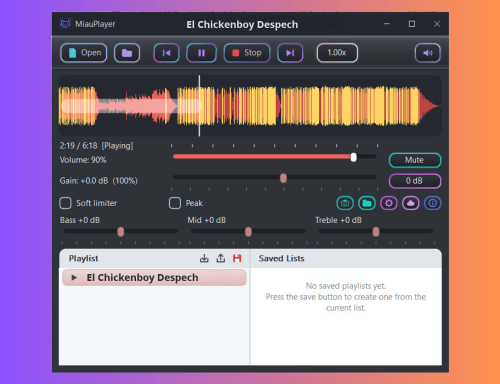

<p align="center">
  
</p>

# MiauPlayer

Reproductor de **audio y video** para Windows, ligero y con interfaz dibujada a medida: forma de onda con busqueda al hacer clic,
**ganancia, ecualizador de 3 bandas, control de velocidad**, playlists guardadas y soporte de rutas de red.
Interfaz en espanol, ingles y portugues. Sin cuentas, sin anuncios, sin telemetria.

<p align="center">
  
</p>

## Que hace

- **Casi cualquier formato.** Audio (MP3, FLAC, M4A, AAC, OGG, OPUS, WAV, WMA, AIFF, APE, DSF...) y video (MP4, MKV, MOV, AVI, WEBM, WMV, MPG...) gracias a FFmpeg.
- **Audio fiel al archivo.** Reproduce a la frecuencia original, sin remuestrear, y entrega el sonido en coma flotante de 32 bits (un archivo de 16 o 24 bits cabe exacto). A volumen 100 %, ganancia 0 dB y ecualizador plano, la senal pasa intacta.
- **Forma de onda.** Muestra toda la pista y permite saltar a cualquier punto con un clic.
- **Volumen y ganancia.** El volumen y la ganancia (de -12 a +10 dB) se ajustan con la rueda del mouse o haciendo clic en una marca; la rueda hacia arriba sube.
- **Ecualizador de 3 bandas** (graves, medios, agudos) y **limitador suave** opcional, con indicador de pico.
- **Velocidad** de reproduccion sin cambiar el tono.
- **Playlists.** Guarda, importa y exporta listas, y reordena las pistas arrastrando, tanto en la lista actual como en las guardadas.
- **Menu de cada pista** (clic derecho): reproducir, abrir la ubicacion del archivo, ver su informacion (tipo, bitrate, frecuencia y profundidad de bits) y quitarla.
- **Video.** Pantalla completa, lista flotante sobre el video, captura del fotograma actual en una carpeta que tu eliges y, al terminar el ultimo video de la cola, se queda el ultimo fotograma.
- **Rutas de red.** Abre direcciones HTTP, RTSP, RTMP y otras que FFmpeg entienda.
- **Teclas multimedia** del teclado, y asociacion de archivos opcional desde Configuracion.

## Atajos de teclado

| Tecla | Accion |
| --- | --- |
| `Espacio` | Reproducir / pausa |
| `Izquierda` / `Derecha` | Retroceder / adelantar 5 s (con `Ctrl`, 30 s) |
| `Arriba` / `Abajo` | Subir / bajar el volumen |
| `M` | Silenciar |
| `S` | Capturar el fotograma actual |
| `F` o `F11` | Pantalla completa |
| `Esc` | Salir de pantalla completa o cerrar paneles |
| `Re Pag` / `Av Pag` | Pista anterior / siguiente |

## Descarga e instalacion

Descarga `MiauPlayer-Setup-X.Y.Z.exe` desde [Releases](../../releases) y ejecutalo. El instalador usa el idioma de Windows
(se puede cambiar despues en el engranaje de **Configuracion**) y ofrece asociar los tipos de archivo mas comunes.
Windows puede mostrar el aviso de SmartScreen porque el instalador aun no esta firmado.

## Compilar

Lee [COMPILAR.txt](COMPILAR.txt). Resumen: instala MinGW-w64 y NSIS, descarga el build **win64-lgpl-shared** de
[BtbN](https://github.com/BtbN/FFmpeg-Builds/releases), define `FFMPEG` con su carpeta y ejecuta `build.bat`.

```
set FFMPEG=C:\ruta\ffmpeg-master-latest-win64-lgpl-shared
build.bat
```

Usa siempre el build **lgpl**: el build `gpl` te obligaria a publicar todo MiauPlayer bajo GPL, y los `nonfree` no se pueden redistribuir.

## Estructura

| Ruta | Contenido |
| --- | --- |
| `MiauPlayer.cpp` | Todo el programa (C++17, Win32 + GDI+) |
| `app.rc`, `app.manifest`, `app.ico`, `icono_archivo.ico`, `kofi.png` | Recursos: iconos, manifiesto e imagen incrustada |
| `MiauPlayer.nsi` | Script del instalador (NSIS) |
| `build.bat`, `COMPILAR.txt` | Compilacion y empaquetado |
| `msix/` | Paquete MSIX para Microsoft Store (manifiesto, iconos y scripts) |
| `LEEME.txt` | Texto que acompana al instalador |
| `FFMPEG-LICENSE.txt`, `THIRD_PARTY_NOTICES.md` | Licencias y avisos de terceros |
| `PRIVACY.md` | Politica de privacidad |
| `CHANGELOG.md` | Historial de cambios |

## Datos y privacidad

MiauPlayer no recopila ni envia datos. Las preferencias se guardan en tu equipo y las playlists en la carpeta `playlist`
junto al programa (en la version de Microsoft Store, en `Documentos\MiauPlayer\playlist`). Mas detalle en [PRIVACY.md](PRIVACY.md).

## Limitaciones conocidas

- Solo Windows de 64 bits.
- El audio sale siempre en estereo: un archivo mono suena igual por los dos lados y uno multicanal se mezcla a dos canales.
- La salida pasa por el mezclador de Windows (no hay modo exclusivo WASAPI ni ASIO).
- El instalador no esta firmado digitalmente, por eso SmartScreen puede advertirlo.
- En equipos cuyo dispositivo de audio no acepte coma flotante, el sonido pasa a 16 bits y 48 kHz.

## Apoyo

Si MiauPlayer te es util, puedes apoyar el proyecto en [Ko-fi](https://ko-fi.com/miauapps). Mas apps en [ia21.cc](https://ia21.cc).

## Licencias

FFmpeg se distribuye bajo LGPL v3 (enlace dinamico); ver [THIRD_PARTY_NOTICES.md](THIRD_PARTY_NOTICES.md) y `FFMPEG-LICENSE.txt`.
MiauPlayer: MIT (ver [LICENSE](LICENSE)).
